# Repository code flow

OpenCV is a collection of libraries, so there is no single application entry point. This diagram shows a typical image or video processing path. Input sources, algorithms, and output destinations are alternatives; an application chooses the ones it needs.

```mermaid
flowchart LR
    CPP["C++ apps and samples"] --> API["Public OpenCV C++ API"]
    PY["Python apps and samples"] --> LOADER["cv2 package loader"]
    LOADER --> EXT["Native cv2 extension"]
    EXT --> IN["Python and NumPy values to C++ values and cv::Mat"]
    IN --> API

    CMAKE["CMake configuration"] -. "runs" .-> GEN["Python binding generator"]
    HDR["C++ headers: CV_EXPORTS_W / CV_WRAP"] -. "parsed by" .-> GEN
    GEN -. "generated wrappers" .-> EXT

    API --> SELECT{"Input source"}
    SELECT -->|Image file or encoded buffer| CODEC["imgcodecs: imread / imdecode"]
    SELECT -->|Camera or video| CAPTURE["videoio: VideoCapture and selected backend"]
    SELECT -->|Memory| MAT["core: cv::Mat / InputArray"]
    CODEC --> MAT
    CAPTURE --> MAT

    MAT --> PROCESS["imgproc: colors, resizing, filters, geometry"]
    MAT --> ADV["Optional algorithms: dnn / features2d / calib3d / video / more"]
    PROCESS --> ADV
    PROCESS --> RESULT["Processed image or other result"]
    ADV --> RESULT

    RESULT --> GUI["highgui: imshow / waitKey"]
    RESULT --> SAVE["imgcodecs: imwrite or videoio: VideoWriter"]
    RESULT --> COUT["Result returned to C++ caller"]
    RESULT --> PYOUT["Python binding: cv::Mat to NumPy array"]
    PYOUT --> PRET["Result returned to Python caller"]
```

Solid arrows represent a common runtime data path; dashed arrows show how the Python interface is generated at build time. The Python package loads the native extension, whose wrappers convert data between Python/NumPy and C++. C++ programs call the same library modules directly.

## Where to follow the code

| Stage | Source |
| --- | --- |
| Build and generated bindings | [Root CMake configuration](CMakeLists.txt), [binding generation](modules/python/bindings/CMakeLists.txt), [generator](modules/python/src2/gen2.py) |
| Python import and conversion | [cv2 package loader](modules/python/package/cv2/__init__.py), [native extension](modules/python/src2/cv2.cpp), [NumPy and Mat conversion](modules/python/src2/cv2_convert.cpp) |
| Image and video input | [Image decoding](modules/imgcodecs/src/loadsave.cpp), [video capture and backend selection](modules/videoio/src/cap.cpp) |
| Shared data and processing | [cv::Mat](modules/core/include/opencv2/core/mat.hpp), [color conversion](modules/imgproc/src/color.cpp), [Canny edge detection](modules/imgproc/src/canny.cpp) |
| Display and output | [Window display](modules/highgui/src/window.cpp), [image writing](modules/imgcodecs/src/loadsave.cpp), [video writing](modules/videoio/src/cap.cpp) |
| Concrete examples | [C++ edge sample](samples/cpp/edge.cpp), [Python edge sample](samples/python/edge.py), [Python video helper](samples/python/video.py) |
